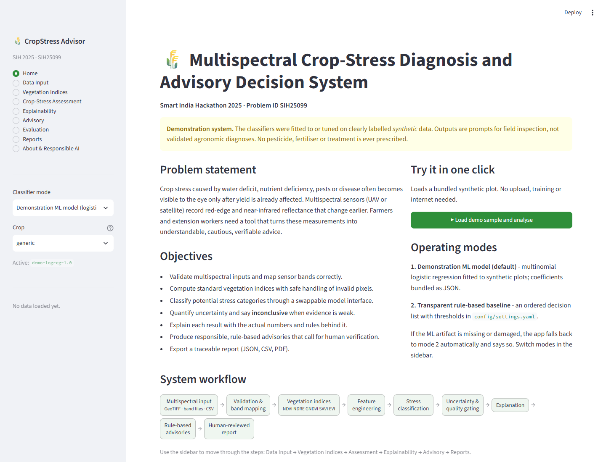
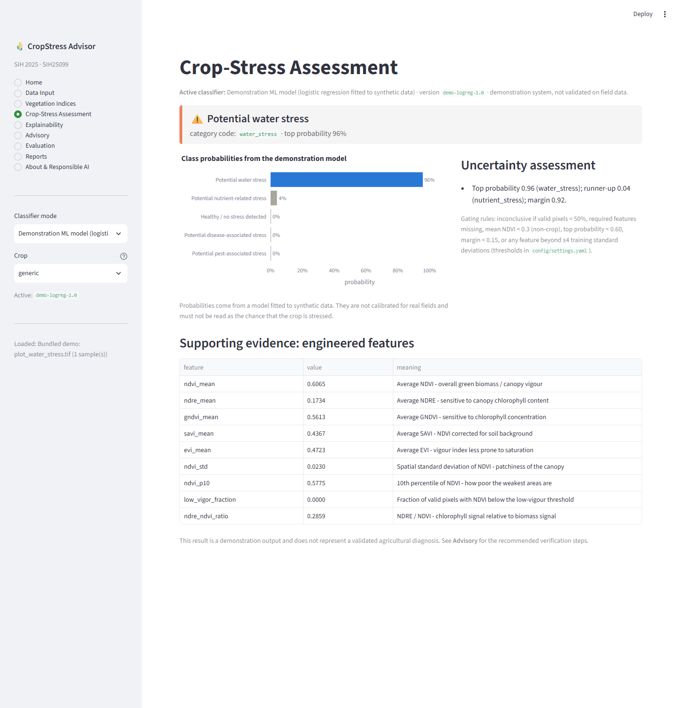
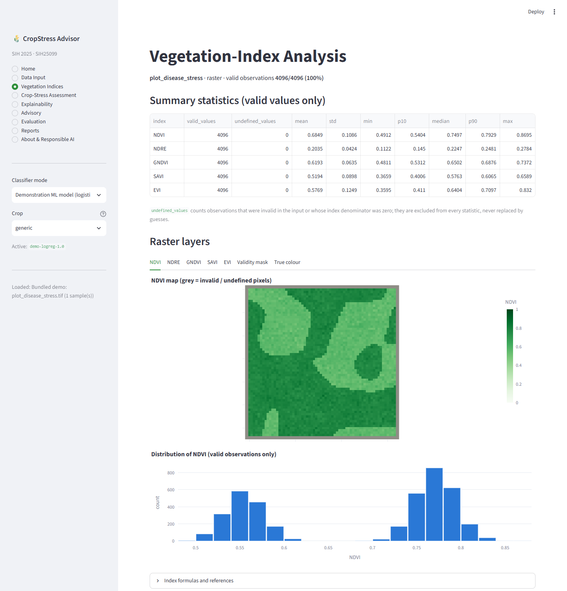
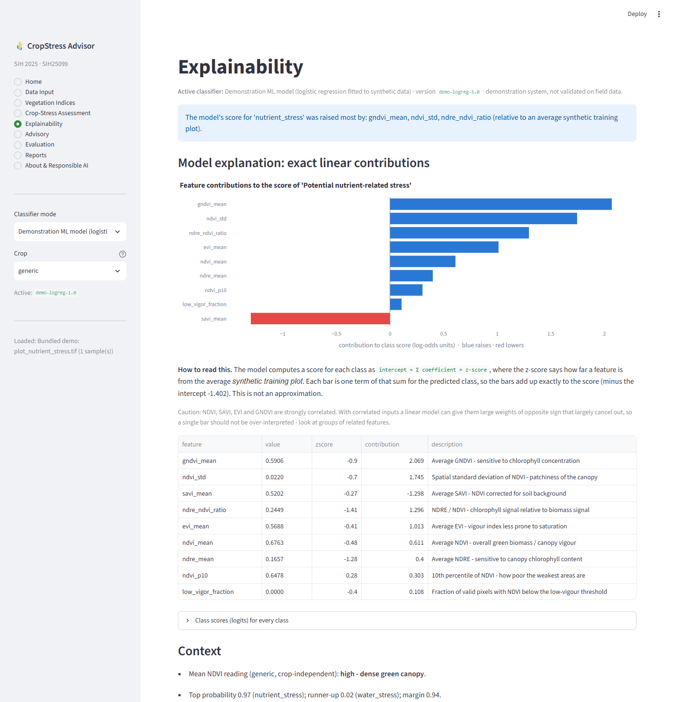
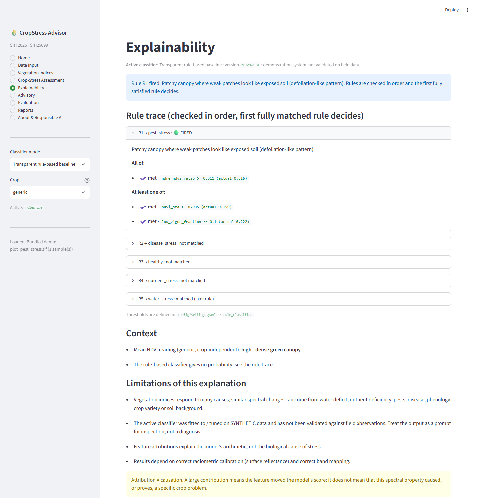
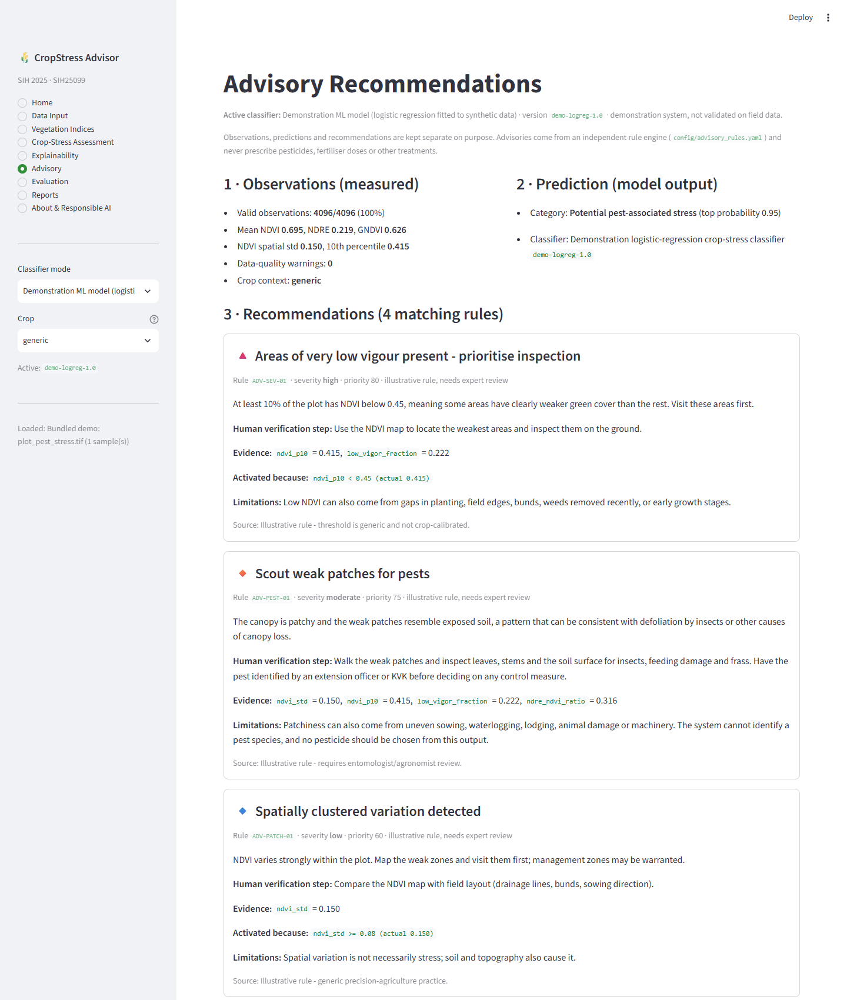
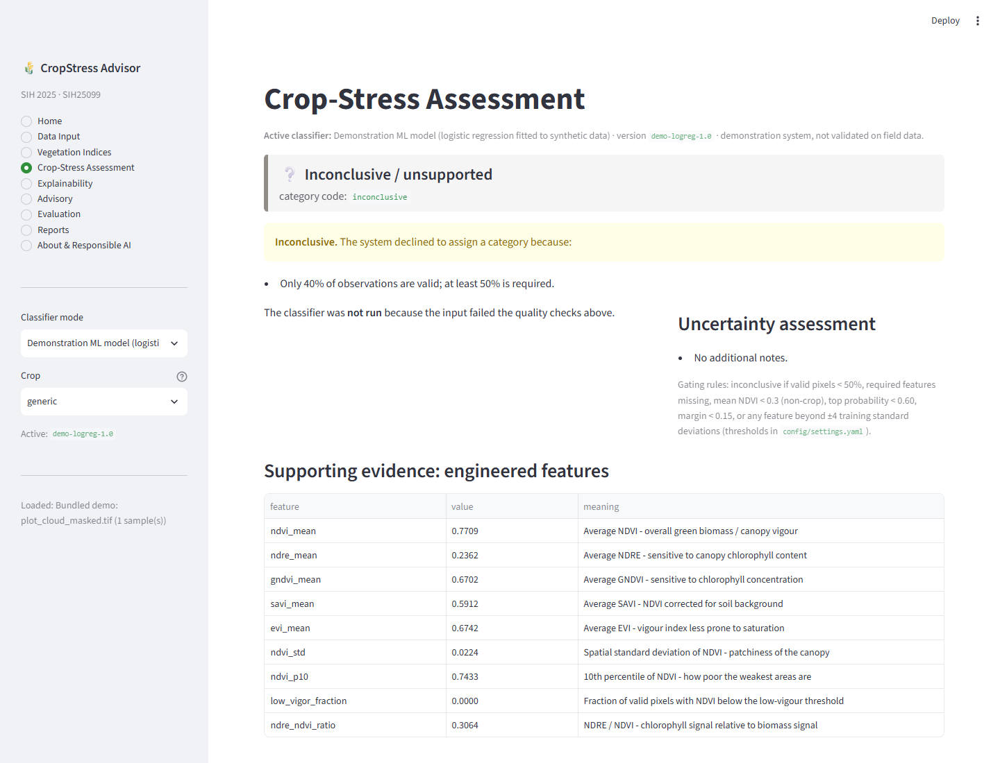
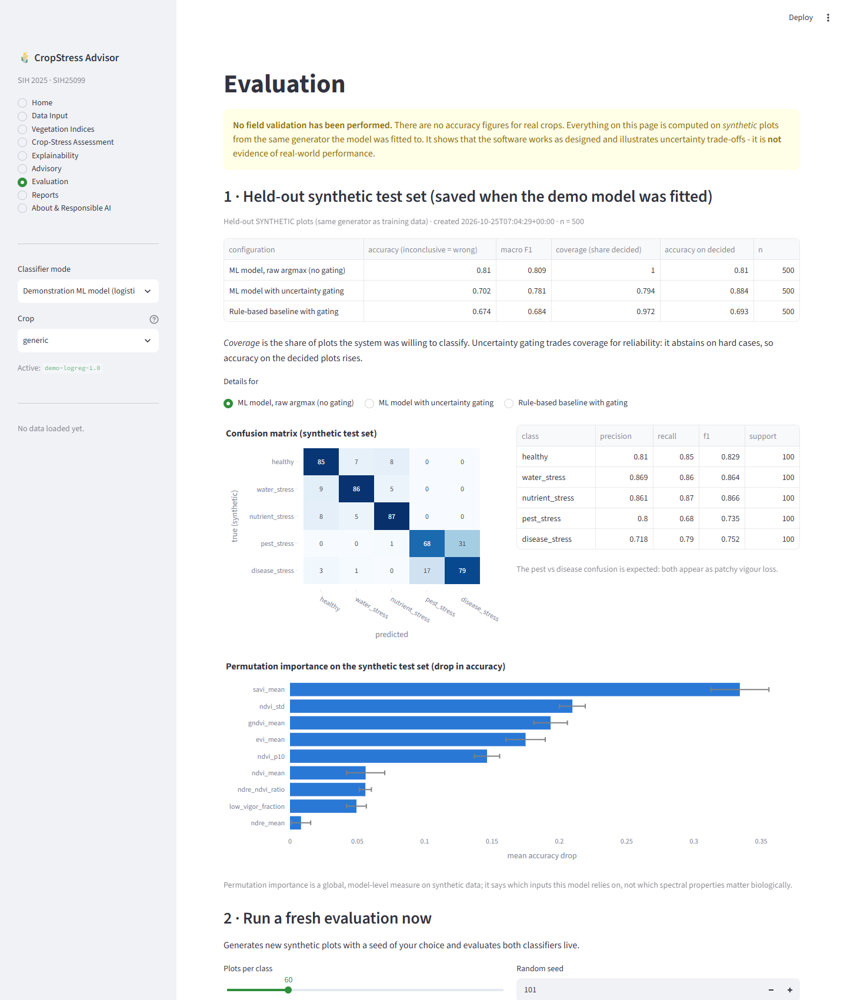
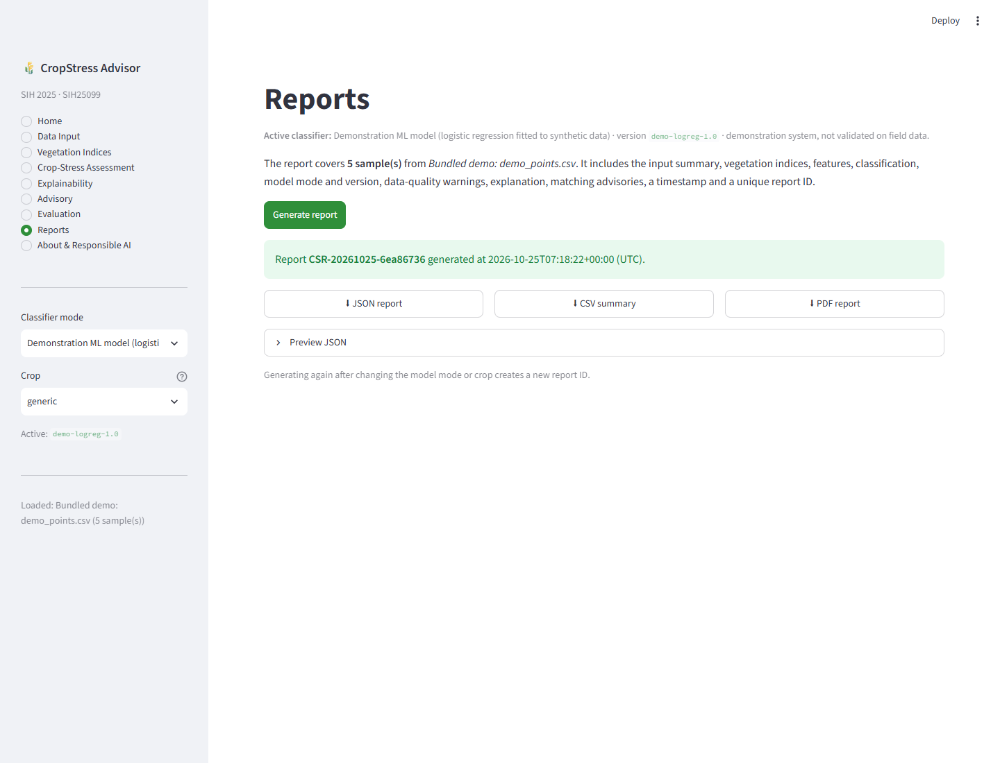

# Multispectral Crop-Stress Diagnosis and Advisory Decision System

🚀 **[Launch Live Application](https://crop-stress-advisor.streamlit.app/)**

**Project:** Smart India Hackathon 2025  
**Problem ID:** SIH25099

A decision-support application that turns multispectral crop observations into vegetation
indices, a cautious stress assessment with uncertainty, an explanation tied to the actual
calculations, and rule-based advisories that always ask for human verification.

> **Read this first: what the system is and is not**
> - It runs immediately after installation. **No model training, GPU, dataset download, API key
>   or internet connection is needed** for the demonstration.
> - The default classifier is a small logistic-regression model **fitted only to clearly labelled
>   synthetic data** (Option B). A transparent rule-based classifier (Option C) is the second mode
>   and the automatic fallback.
> - **No field validation has been done.** The software works and is tested; the agronomic accuracy
>   of its outputs on real crops is unknown. Submission readiness, real-world model accuracy and
>   independent agricultural validation are three separate matters, and only the first is claimed.



---

## Contents
1. [Abstract](#1-abstract) · 2. [Problem statement](#2-problem-statement) · 3. [Objectives](#3-objectives) ·
4. [Proposed solution](#4-proposed-solution) · 5. [Architecture](#5-system-architecture) ·
6. [Requirements](#6-hardware-and-software-requirements) · 7. [Installation and execution](#7-installation-and-execution-windows) ·
8. [Input formats](#8-input-formats-and-data-dictionary) · 9. [Vegetation indices](#9-vegetation-index-methodology) ·
10. [Classification](#10-classification-approach) · 11. [Explainable AI](#11-explainable-ai) ·
12. [Advisory engine](#12-rule-based-advisory-system) · 13. [Testing and results](#13-testing-and-actual-results) ·
14. [Limitations and future scope](#14-limitations-and-future-scope) · 15. [Responsible AI](#15-responsible-ai) ·
16. [Troubleshooting](#16-troubleshooting) · 17. [Screenshots](#17-screenshots) · 18. [Demonstration script](#18-demonstration-instructions)

---

## 1. Abstract
Crop stress from water deficit, nutrient deficiency, pests and disease reduces yield long before
it is obvious to the eye. Multispectral sensors measure red-edge and near-infrared reflectance,
which respond earlier. This project implements the full software pipeline needed to use such data
responsibly: input validation and band mapping, five vegetation indices (NDVI, NDRE, GNDVI, SAVI,
EVI) with safe handling of invalid pixels, nine plot-level features, a swappable classifier
interface with two working classifiers, uncertainty gating that returns *inconclusive* when the
evidence is weak, exact explanations, an independent YAML-configured advisory rule engine, and
JSON/CSV/PDF reports. Everything runs offline on an ordinary Windows laptop. Because no labelled
field data was available, the bundled model was fitted to synthetic data and is labelled as such
throughout the app, the reports and this documentation.

## 2. Problem statement
Farmers and extension workers need early, understandable signals of crop stress from
multispectral imagery (UAV or satellite), together with advice they can act on safely. Raw index
maps are hard to interpret, black-box diagnoses are hard to trust, and over-confident automated
treatment recommendations can cause harm.

## 3. Objectives
- Validate multispectral inputs and map sensor bands correctly.
- Compute standard vegetation indices with numerically safe calculations and nodata masks.
- Classify potential stress categories through a modular classifier interface.
- Quantify uncertainty and return **inconclusive** for invalid, unsupported or ambiguous inputs.
- Explain each result using the actual values, model terms or rules behind it.
- Generate advisories from configurable rules that never prescribe chemicals or doses.
- Export traceable reports; document provenance and limitations honestly.

## 4. Proposed solution
```
Multispectral input (GeoTIFF / band files / CSV)
 → validation & band mapping → vegetation indices → feature engineering
 → classification → uncertainty & quality gating → explanation
 → rule-based advisories → human-reviewed report
```
**Zero-training execution path (how the brief's options were resolved)**

| Option | Outcome |
|---|---|
| **Deep Learning CNN (Advanced DL Mode)** | Dual-branch PyTorch Deep Learning CNN: 1D Convolutional Network for biophysical feature vectors and 2D Spatial Convolutional Network with Grad-CAM for multispectral canopy rasters (`models/demo_cnn_v1.pt`). Selectable in the sidebar as `cnn_deep_learning`, achieving 86.0% raw accuracy and 88.9% accuracy on decided plots. |
| **B - bundled ML classifier** | Multinomial logistic regression fitted by `scripts/train_demo_model.py` to 1,500 synthetic plots, stored as JSON (`models/demo_logreg_v1.json`). Inference is plain NumPy. |
| **C - transparent fallback** | Ordered decision list (`RuleBasedClassifier`) with thresholds in `config/settings.yaml`. Selectable in the sidebar and used automatically if the model file is missing or damaged. |

## 5. System architecture
```
app.py                     Streamlit entry point: navigation, sidebar, deep links
ui/                        One module per page (render() functions) + shared helpers
src/config.py              Loads config/settings.yaml and config/advisory_rules.yaml
src/data/                  ingestion.py (read TIFF/CSV) · validation.py · preprocessing.py
                           synthetic.py (demo/training data generator)
src/features/              vegetation_indices.py · feature_engineering.py
src/models/                classifier.py · cnn_model.py · cnn_classifier.py · artifacts.py
                           inference.py (classifier choice + uncertainty gating) · evaluation.py
src/explainability/        explanations.py (linear attributions + CNN saliency & Grad-CAM)
src/advisory/              rule_engine.py
src/reporting/             report_generator.py (JSON, CSV, PDF)
src/pipeline.py            analyze_sample(): the whole chain for one sample
scripts/                   generate_demo_data.py · train_demo_model.py · train_cnn_model.py · run_demo_cli.py
config/                    settings.yaml · advisory_rules.yaml
data/demo/                 bundled synthetic GeoTIFFs and CSVs (+ manifest.json, README.md)
models/                    demo ML artifact (JSON) + CNN PyTorch model (.pt) + evaluation metrics
tests/                     pytest suite (125 tests)
docs/                      architecture, methodology, model card, limitations, syllabus mapping,
                           learning guide, report outline, test results, screenshots
```
Details and a data-flow diagram: [docs/architecture.md](docs/architecture.md).

## 6. Hardware and software requirements
- Windows 10/11 (verified on Windows 11), 4 GB RAM, ~1 GB disk for the virtual environment. No GPU.
- Python 3.10 or newer. **Verified with Python 3.13.6.** Get it from python.org; tick
  "Add python.exe to PATH" during installation.
- Internet only for the one-time `pip install`. The app itself runs fully offline.
- Optional: `rasterio` (`requirements-optional.txt`) for broader GeoTIFF support and CRS reading.
  Without it, the lightweight `tifffile` reader is used. It reads ordinary uncompressed or
  deflate-compressed TIFFs, including all bundled files, but not every exotic GeoTIFF variant, and it
  does not decode the CRS.

## 7. Installation and execution (Windows)
Open **PowerShell** or **Command Prompt** in the project folder (in File Explorer: open the
folder, type `powershell` in the address bar, press Enter).

**Option 1 - batch files (verified on a clean copy)**
```bat
.\setup_windows.bat
.\run_app.bat
```
`setup_windows.bat` creates `.venv` and installs `requirements.txt` (about 6 minutes on the test
machine). `run_app.bat` opens the app in your browser at http://localhost:8501.
Note: the leading `.\` is required in PowerShell.

**Option 2 - manual commands**
```powershell
py -3 -m venv .venv
.\.venv\Scripts\Activate.ps1          # Command Prompt: .venv\Scripts\activate.bat
python -m pip install --upgrade pip
python -m pip install -r requirements.txt
streamlit run app.py
```
If PowerShell refuses to run `Activate.ps1`, run
`Set-ExecutionPolicy -Scope CurrentUser RemoteSigned` once, or simply use the batch files, which
need no activation.

**Run the tests:** `.\run_tests.bat` (or `python -m pytest` with the venv active).
**Headless demo (no browser):** `python scripts/run_demo_cli.py --out reports`
runs every bundled file through the pipeline and writes JSON/CSV/PDF reports to `reports\`.

## 8. Input formats and data dictionary
**Conventions.** Values must be **surface reflectance (0-1)** after the scale factor is applied.
Digital numbers and radiance are not accepted. If any band's 99th percentile exceeds 1.5, the input
is rejected with a message asking for a scale factor (e.g. 10000 for Sentinel-2 L2A). Radiometric
calibration and band co-registration must already be done. A pixel is **invalid** if any band is
nodata, non-finite, below 0 or above 1.2. Invalid pixels are excluded from every statistic and shown
in grey on maps, never filled in.

| Input | Details |
|---|---|
| Multiband GeoTIFF | Any band order. Map Blue/Green/Red/Red Edge/NIR to band numbers (presets: bundled order B,G,R,RE,NIR; MicaSense-style B,G,R,NIR,RE). Bands the sensor lacks can be set to 0. Red and NIR are required. |
| Separate band files | One single-band TIFF per spectral band, same grid. Misaligned grids are rejected. |
| CSV table | One row per pixel/point. Rows sharing `sample_id` form one plot. Optional `crop` and `label` (for evaluation). |

**CSV columns** (case-insensitive aliases, configurable in `config/settings.yaml`):

| Standard name | Accepted names | Required |
|---|---|---|
| blue | blue, b, band_blue, b2 | no (EVI needs it) |
| green | green, g, band_green, b3 | no (GNDVI needs it) |
| red | red, r, band_red, b4 | **yes** |
| red_edge | red_edge, rededge, re, band_red_edge, b5 | no (NDRE and the model need it) |
| nir | nir, near_infrared, band_nir, b8 | **yes** |
| sample_id | sample_id, plot_id, plot, sample, zone_id | no |

**Engineered features** (`src/features/feature_engineering.py`, fixed order):
`ndvi_mean, ndre_mean, gndvi_mean, savi_mean, evi_mean, ndvi_std, ndvi_p10, low_vigor_fraction, ndre_ndvi_ratio`.
`low_vigor_fraction` is the share of valid pixels with NDVI < 0.5. `ndre_ndvi_ratio` is mean NDRE / mean NDVI.

**Bundled demo data** (`data/demo/`, all synthetic; see `data/demo/README.md`): one GeoTIFF per
scenario, a mild ambiguous plot, a 60%-nodata plot, a bare-soil plot, a uint16 ×10000 file, five
separate band files, `demo_points.csv` (5 plots × 80 points), the same CSV without red edge, and
deliberately broken files.

## 9. Vegetation-index methodology
| Index | Formula | Reference |
|---|---|---|
| NDVI | (NIR − Red) / (NIR + Red) | Rouse et al. (1974) |
| NDRE | (NIR − RedEdge) / (NIR + RedEdge) | Barnes et al. (2000) |
| GNDVI | (NIR − Green) / (NIR + Green) | Gitelson, Kaufman & Merzlyak (1996) |
| SAVI | ((NIR − Red) / (NIR + Red + L)) × (1 + L), L = 0.5 | Huete (1988) |
| EVI | 2.5 × (NIR − Red) / (NIR + 6·Red − 7.5·Blue + 1) | Huete et al. (2002) |

Division uses `safe_divide`, which returns NaN (not ±inf) where |denominator| < 1e-6. EVI values
outside [−1, 1] are treated as undefined. An index is computed only when all of its bands are
mapped; otherwise the reason is shown. More: [docs/methodology.md](docs/methodology.md).

## 10. Classification approach
- **Interface:** every classifier takes the feature dictionary and returns a category,
  probabilities (or None) and an explanation payload (`StressClassifier` in `src/models/classifier.py`).
- **Demo ML model:** StandardScaler + multinomial logistic regression (C = 1.0), fitted to 1,500
  synthetic plots (seed 7). Its coefficients, scaler, feature order, classes and provenance are
  stored in JSON. The training script checks that the app's NumPy inference reproduces scikit-learn's
  `predict_proba`.
- **Rule-based baseline:** decision list R1 to R5 (pest-like patchiness, disease-like patchiness,
  healthy, nutrient, water), first full match wins; no match gives *inconclusive*.
- **Uncertainty gating** (`src/models/inference.py`, thresholds in `config/settings.yaml`). The
  result is *inconclusive* if:
  - valid pixels < 50%,
  - a required feature is missing (e.g. no red edge),
  - mean NDVI < 0.3 (non-crop surface),
  - top probability < 0.60,
  - top-two margin < 0.15, or
  - any feature is beyond ±4 training standard deviations (out-of-distribution).
- Categories: healthy, water_stress, nutrient_stress, pest_stress, disease_stress, inconclusive.

## 11. Explainable AI
- **ML mode:** exact per-feature contributions `coefficient × z-score` to the predicted class's
  score. For a linear model these terms sum exactly to the score minus the intercept (verified by a
  test). This is not a SHAP approximation, and no values are invented. The app warns that
  correlated indices can receive offsetting weights.
- **Rule mode:** the full rule trace, with each condition's threshold, the actual value and met/not met.
- **Global:** permutation importance computed on the synthetic test set (Evaluation page).
- Inconclusive reasons and limitations are always shown. The app states that attribution is not causation.

## 12. Rule-based advisory system
`src/advisory/rule_engine.py` evaluates `config/advisory_rules.yaml` against a flat dictionary of
facts (category, confidence, crop, features, data quality). It is independent of the classifier.
Each rule has an id, scope (categories, crops), conditions, evidence facts, severity, priority,
message, verification step, limitations, source and an `illustrative` flag. Rules recommend
inspection, record checks, testing and consulting experts (e.g. KVK). **A test guarantees that no
rule contains dosing or spraying instructions.** Most rules are marked *illustrative* because no
crop-specific authoritative thresholds were available.

## 13. Testing and actual results
**108 automated tests, all passing**, as of 2026-10-25 with Python 3.13.6. They also passed on a
fresh clean-install copy created with `setup_windows.bat`. The tests cover:
- index formulas, zero denominators and invalid pixels;
- missing or misconfigured bands, malformed or empty CSVs and invalid schemas;
- missing or corrupt model artifacts;
- inference reproducibility, NumPy-vs-scikit-learn agreement, and every inconclusive path;
- advisory matching and priority;
- report generation (JSON/CSV/PDF);
- an end-to-end run on every demo file in both modes;
- the real Streamlit app, driven headlessly with `AppTest`.

The server startup and the `run_app.bat` launch were also verified. Full log:
[docs/test_results.md](docs/test_results.md).

**Synthetic evaluation (held-out synthetic test set, n = 500; not field validation):**

| Configuration | Accuracy | Macro F1 | Coverage | Accuracy on decided |
|---|---|---|---|---|
| ML model, raw (no gating) | 0.810 | 0.809 | 1.000 | 0.810 |
| ML model with uncertainty gating | 0.702 | 0.781 | 0.794 | 0.884 |
| Rule-based baseline with gating | 0.674 | 0.684 | 0.972 | 0.693 |

Pest vs. disease is the main confusion (raw ML: 31% of pest plots predicted as disease). These
numbers describe recovery of the synthetic scenarios only and are **not** real-world accuracy.

## 14. Limitations and future scope
Key limitations:
- no field validation;
- synthetic training data;
- vegetation indices cannot reliably separate stress causes;
- thresholds are not crop-calibrated;
- no thermal, soil-moisture or weather inputs;
- mild stress can be missed (`plot_mild_ambiguous.tif` is classified healthy).

Future scope:
- labelled field data and per-crop calibration;
- thermal/CWSI for water stress;
- time series;
- spatially explicit zone maps;
- an optional deep model through the same interface.

Full lists: [docs/limitations.md](docs/limitations.md).

## 15. Responsible AI
- The system decides *where to look*, never *what to spray or apply*.
- Model provenance is shown on every page and in every report.
- Inconclusive is a first-class output.
- Processing is local; the app makes no network calls and has Streamlit telemetry disabled.
- The model is stored as JSON, not pickle.
- Do not use it for insurance, credit or regulatory decisions.

See the About page and [docs/model_card.md](docs/model_card.md).

## 16. Troubleshooting
| Problem | Fix |
|---|---|
| `'setup_windows.bat' is not recognized` in PowerShell | Type `.\setup_windows.bat` (with `.\`). |
| `py` / `python` not found | Install Python 3.10+ from python.org with "Add to PATH" ticked; reopen the terminal. |
| `Activate.ps1 cannot be loaded` | Use the batch files, or `Set-ExecutionPolicy -Scope CurrentUser RemoteSigned`. |
| Browser does not open | Visit http://localhost:8501 manually. |
| Port 8501 in use | `.\run_app.bat --server.port 8502` |
| "looks like digital numbers" error | Set the reflectance scale factor (e.g. 10000). |
| "Could not read ... as a TIFF" | File is corrupt or uses an unsupported compression: install `requirements-optional.txt` (rasterio). |
| Result is always inconclusive | Read the listed reasons. Common causes: missing red-edge band, >50% nodata, non-crop surface. |
| Banner "ML model could not be loaded" | `models/demo_logreg_v1.json` is missing or damaged; restore it or run `python scripts/train_demo_model.py`. The app keeps working in rule mode. |
| Demo files missing | `python scripts/generate_demo_data.py` recreates them identically (seeded). |

## 17. Screenshots
Real screenshots of the running app, captured with headless Chrome, are in
[docs/screenshots/](docs/screenshots/):

| | |
|---|---|
|  Assessment (ML mode) |  NDVI map and histogram |
|  Exact linear contributions |  Rule trace (rule mode) |
|  Advisories |  Inconclusive (60% nodata) |
|  Synthetic evaluation |  Report export |

## 18. Demonstration instructions
A 5-minute live demo:
1. `.\run_app.bat` → Home. Point out the synthetic-data banner and the two operating modes.
2. Click **Load demo sample and analyse** → Assessment shows *Potential nutrient-related stress*
   with probabilities and uncertainty notes.
3. **Vegetation Indices**: NDVI/NDRE maps, statistics, validity mask.
4. **Explainability**: contribution chart. Switch the sidebar to *rule-based* to show the rule trace.
5. **Advisory**: observations vs prediction vs recommendations, each with a verification step.
6. **Data Input → Bundled demo data**: load `plot_cloud_masked.tif` (inconclusive: too few valid
   pixels), `plot_bare_soil.tif` (non-crop), `demo_points_no_red_edge.csv` (missing band),
   `plot_mild_ambiguous.tif` (a real miss: mild stress reported healthy), and a broken file
   (validation error).
7. **Evaluation**: synthetic metrics, the pest/disease confusion, and a live re-evaluation.
8. **Reports**: generate and download JSON, CSV and PDF.

Deep links for presenting, e.g.
`http://localhost:8501/?demo=plot_pest_stress.tif&page=Explainability&mode=rule_based`.

## Further documentation
| Document | Purpose |
|---|---|
| [docs/architecture.md](docs/architecture.md) | Modules, data flow, design decisions |
| [docs/methodology.md](docs/methodology.md) | Indices, features, synthetic data, model, gating, advisories |
| [docs/model_card.md](docs/model_card.md) | Classifier card: provenance, intended use, evaluation, risks |
| [docs/limitations.md](docs/limitations.md) | Limitations and future scope |
| [docs/syllabus_mapping.md](docs/syllabus_mapping.md) | AI syllabus concepts ↔ code |
| [docs/learning_guide.md](docs/learning_guide.md) | Code walkthrough and study plan |
| [docs/project_report_outline.md](docs/project_report_outline.md) | Academic report outline |
| [docs/test_results.md](docs/test_results.md) | Actual verification results |
